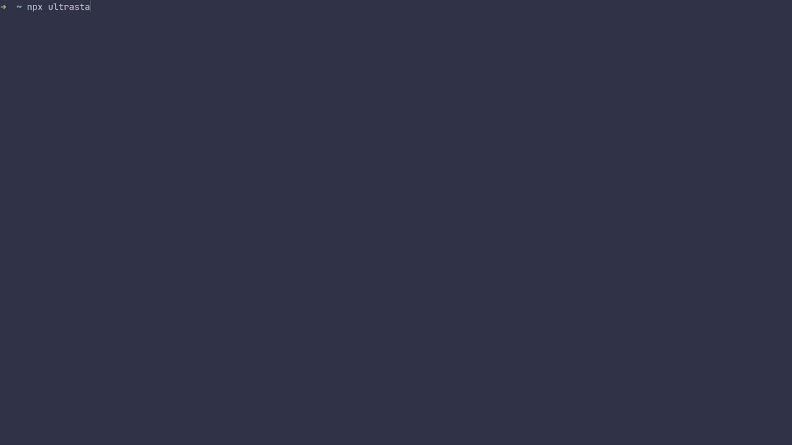

# UltraStar CLI Plus



Fork do [UltraStar CLI](https://github.com/martiinii/UltraStar-CLI) com extras prontos para uso:

- Filtro de idioma na busca (USDB)
- Download nativo do YouTube com fallback para `yt-dlp`
- Interface multilíngue (i18n)
- Normalização de volume do áudio
- Separação de áudio/vídeo pelos labels `AUDIO` / `VIDEO` do USDB

Pacote npm: [`ultrastar-cli-plus`](https://www.npmjs.com/package/ultrastar-cli-plus)

## Requirements

- yt-dlp (recomendado; usado como fallback)
- Node.js (npm/npx) ou Bun

### Install yt-dlp
- macOS: `brew install yt-dlp` ou `pipx install yt-dlp`
- Windows: `winget install yt-dlp.yt-dlp` ou `choco install yt-dlp`
- Linux: pacote da distro ou `pipx install yt-dlp`

Veja também: https://github.com/yt-dlp/yt-dlp#installation

## Quick Start

### npm / npx
```bash
npx ultrastar-cli-plus
```

### Instalação global
```bash
npm i -g ultrastar-cli-plus
ultrastar-plus
```

### Bun
```bash
bunx --bun ultrastar-cli-plus
```

Na primeira execução o CLI verifica o yt-dlp e cria a sessão. Busque, escolha a música e pressione Enter. As pastas vão para `./songs/Artist - Title/`.

## Keyboard Shortcuts
- No formulário: Tab = campo, Enter = buscar, Esc = sair
- Nos resultados: ↑/↓ = selecionar, Enter = baixar, ←/→ = página, e = editar, r = atualizar, l = idioma, Esc = voltar

## Links
- https://usdb.animux.de — maior base de letras UltraStar
- https://ultrastar-es.org/ — base menor com áudio/vídeo
- Upstream original: https://github.com/martiinii/UltraStar-CLI

## Develop

Este projeto usa Bun.

```bash
bun install
bun run start      # TUI em desenvolvimento
bun run build     # artefatos em ./build
bun run lint
bun run format
```

### Estrutura
- `src/ui/` — TUI (Ink)
- `src/api/` — USDB e YouTube
- `src/storage/` — cache local (credenciais, histórico)
- `src/i18n/` — traduções
- `src/build.ts` — bundler Bun

## Releases

Push na `main` dispara automaticamente: bump de versão → GitHub Release → publish no npm.

## Troubleshooting
- yt-dlp não encontrado: instale e garanta que está no PATH
- Sem resultados: tente menos filtros ou outras palavras
- Permissão ao gravar: rode em uma pasta sua
